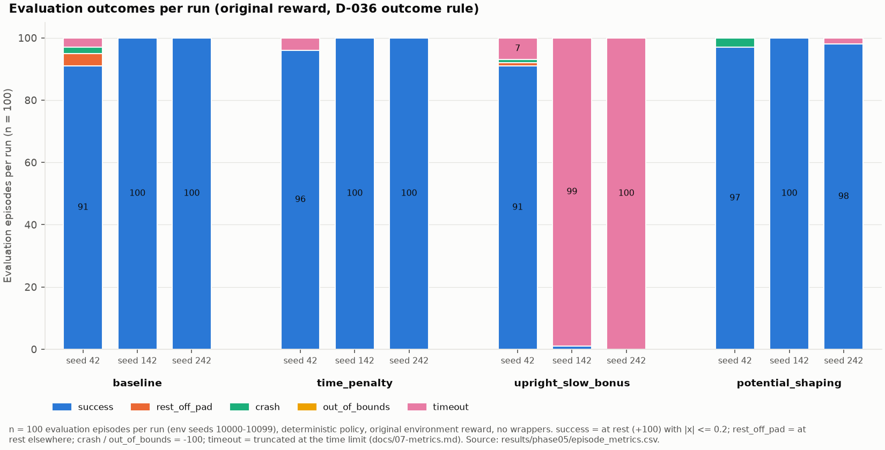
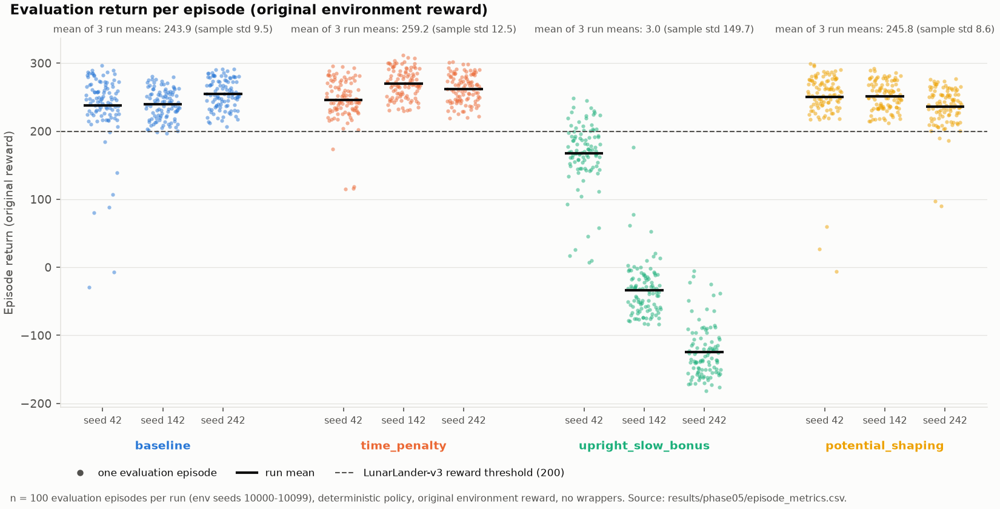
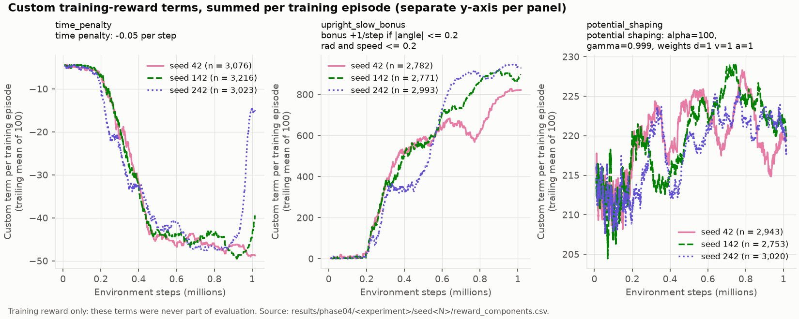
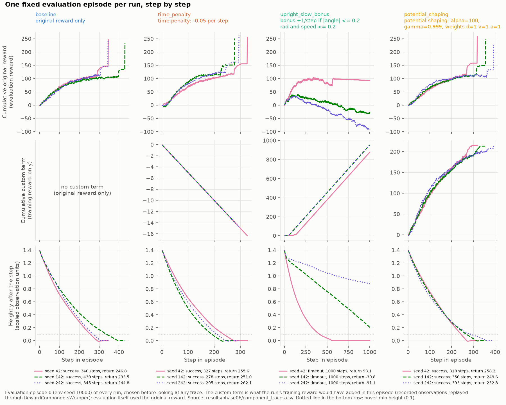
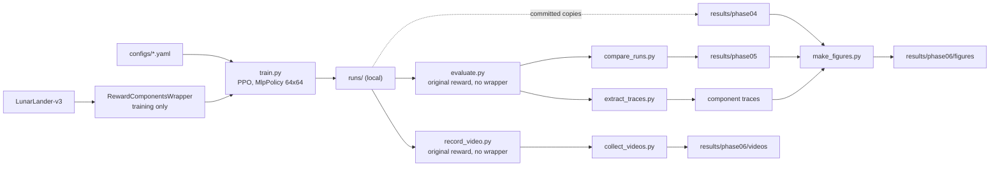

# Reward Engineering on Lunar Lander with PPO

How does the reward an agent is trained on change what it learns? This
project trains PPO agents on Gymnasium's `LunarLander-v3` under four reward
designs. It then evaluates every policy on the **original** environment
reward, so that the designs are compared on the actual task rather than on
their own scores.

| Configuration | Training reward = original reward + |
|---|---|
| `baseline` | nothing |
| `time_penalty` | −0.05 per step |
| `upright_slow_bonus` | +1 per step while \|angle\| ≤ 0.2 rad and speed ≤ 0.2. This bonus is flawed on purpose: it ignores position and landing |
| `potential_shaping` | 100·(0.999·Φ(s′) − Φ(s)), with Φ(s) = −(distance to pad + speed + \|angle\|) and Φ(s′) = 0 on termination |

**Main result.**
- The flawed upright-and-slow bonus was exploited. Its training reward rose
  to 950–979 per episode while its success on the task fell to 92/300
  episodes. Two of its three seeds mostly stay in the air until the time
  limit.
- The other three designs all solve the task (291–296/300 successes).
  Three seeds are not enough to tell them apart.

Stack: Python 3.12, Gymnasium 1.4 (Box2D), Stable-Baselines3 2.9 PPO
(`MlpPolicy`, [64, 64]), PyTorch (CPU), Matplotlib. Windows 11 /
PowerShell. No GPU is needed.

## Results

Setup:
- 4 configurations × 3 training seeds (42, 142, 242), with 1M timesteps per
  run.
- Each run is evaluated on 100 deterministic episodes (env seeds
  10000–10099), the same for every run, on the original reward with no
  wrapper.
- The training seed is the unit of replication. With n = 3 per
  configuration, no significance tests are reported.

| Configuration | Mean return (± sample std over 3 seeds) | Success, pooled | Success by seed (42 / 142 / 242) | Timeouts, pooled | Mean length (steps) |
|---|---|---|---|---|---|
| baseline | 243.9 ± 9.5 | 291/300 | 91 / 100 / 100 | 3 | 395 |
| time_penalty | 259.2 ± 12.5 | 296/300 | 96 / 100 / 100 | 4 | 323 |
| upright_slow_bonus | 3.0 ± 149.7 | 92/300 | 91 / 1 / 0 | 206 | 925 |
| potential_shaping | 245.8 ± 8.6 | 295/300 | 97 / 100 / 98 | 2 | 392 |

"Success" means the lander came to rest (+100) with |x| ≤ 0.2, on the pad.
The outcome rules are in [`docs/07-metrics.md`](docs/07-metrics.md). The
table is generated from
[`results/phase05/`](results/phase05/), and every figure below comes from
committed data ([`docs/visualization.md`](docs/visualization.md)).





### Detailed evaluation metrics

The same 300 evaluation episodes per configuration (3 seeds × 100), broken
down further. Definitions are in [`docs/07-metrics.md`](docs/07-metrics.md).

| Configuration | Crash | Rest off pad | Out of bounds | Hover episodes (diagnostic) | First leg contact, median step (episodes with contact) | Main-engine steps / episode | Side-engine steps / episode |
|---|---|---|---|---|---|---|---|
| baseline | 2/300 | 4/300 | 0/300 | 68/300 | 324.5 (300/300) | 195 | 94 |
| time_penalty | 0/300 | 0/300 | 0/300 | 0/300 | 268.0 (300/300) | 152 | 97 |
| upright_slow_bonus | 1/300 | 1/300 | 0/300 | 300/300 | 713.0 (101/300) | 517 | 394 |
| potential_shaping | 3/300 | 0/300 | 0/300 | 84/300 | 339.5 (300/300) | 195 | 96 |

- **Hover** is a diagnostic, not an outcome. It means at least 100
  consecutive steps with both legs off the ground, height y ≥ 0.1 and
  speed ≤ 0.2. A slow final descent can also count, so the baseline's
  68/300 is the false-positive reference.
- **Engine steps** count the steps with a main or side engine firing. Fuel
  is unlimited; its cost appears only in the reward.
- Engine steps are means of the per-run means. Timeouts are in the table
  above.

### Early training to evaluation

Each configuration's training logs record the original reward of every
training episode, alongside the configuration's own training reward. This
shows how far each design moved on the actual task:

| Configuration | Early training (episodes ending before 100k steps) | Late training (episodes ending at or after 900k steps) | Deterministic evaluation | Change, early to evaluation |
|---|---|---|---|---|
| baseline | −133.0 ± 5.2 | 231.1 ± 19.0 | 243.9 ± 9.5 | −133 → +244 |
| time_penalty | −130.0 ± 2.1 | 194.7 ± 45.9 | 259.2 ± 12.5 | −130 → +259 |
| upright_slow_bonus | −134.3 ± 1.2 | 83.7 ± 42.0 | 3.0 ± 149.7 | −134 → +3 |
| potential_shaping | −128.6 ± 3.1 | 175.5 ± 45.7 | 245.8 ± 8.6 | −129 → +246 |

- **Values:** all are the original task reward, as mean ± sample std over
  the 3 seeds of each seed's mean.
- **Training columns:** these come from the stochastic training policy.
  - The early window starts from an untrained policy and already includes
    about 6 policy updates.
  - The 100k window was chosen after training, to mirror the late window.
- **Evaluation column:** it uses a deterministic policy. Part of the gain
  from late training to evaluation may come from switching to
  deterministic actions; that effect was not measured separately.
- **Sources:** these numbers were computed post hoc from
  `reward_components.csv` in [`results/phase04/`](results/phase04/) and
  from [`results/phase05/`](results/phase05/). No committed script
  produces them. The late-training values match
  `training_vs_evaluation.csv`.

How it was done:
- **Training:** PPO from Stable-Baselines3 with the RL Baselines3 Zoo
  hyperparameters for `LunarLander-v3`. That means 16 parallel
  environments, 1M timesteps (2,753–3,382 training episodes per run),
  γ = 0.999 and an entropy bonus of 0.01. The network is the [64, 64]
  `MlpPolicy`. Every configuration uses the same settings and seeds; only
  the reward changes.
- **Reward design:** each configuration adds one term to the original
  reward during training (table at the top). Evaluation always uses the
  original reward, with a deterministic policy.
- **Compared with the baseline** (descriptive; 3 seeds cannot establish
  these differences):
  - **time_penalty:** in evaluation, first leg contact came earlier
    (median step 268.0 against 324.5). Main-engine use was lower (152
    against 195 steps per episode). It had no crashes and no rest-off-pad
    outcomes.
  - **potential_shaping:** no detectable change in evaluation. In training,
    2 of its 3 seeds never reached a 200 rolling mean (below).
  - **upright_slow_bonus:** improved least (−134 → +3). Two of its three
    seeds learned to collect the bonus instead of landing (next section).

### Training metrics: task performance, PPO health, sample efficiency

These tables cover the training metrics the project owner asked for: task
performance, PPO health and sample efficiency. They report the values that
were measured. Where the owner's checklist gave reference ranges, the
tables also show how many values fall inside them; those ranges are rules
of thumb, not cited sources. Values are given per seed (42 / 142 / 242) or
as mean ± sample std over the 3 seeds. All comparisons are descriptive.

**Task performance.** Gymnasium's "solved" threshold is 200 points per
episode.
- **Evaluation:** all 9 baseline, time_penalty and potential_shaping runs
  averaged above 200 in deterministic evaluation, from 236.0 to 269.9.
  The 3 upright_slow_bonus runs averaged 167.7, −34.0 and −124.7.
- **Training:** the final training-time mean is about equal to evaluation
  for the baseline (244.0 against 243.9). It is lower for the shaped
  configurations. Two possible reasons, neither tested: the training
  policy samples its actions, and in the shaped runs it optimises a
  different reward.

| Configuration | Success rate (evaluation) | Crash rate, −100 endings (evaluation) | Mean episode length, evaluation (steps) | Training reward, final 100-episode mean | Training episode length, final 100-episode mean (`rollout/ep_len_mean`) |
|---|---|---|---|---|---|
| baseline | 97.0% ± 5.2 | 0.7% (2/300) | 392 / 437 / 356 | 244.0 ± 14.7 | 314 / 393 / 364 |
| time_penalty | 98.7% ± 2.3 | 0.0% (0/300) | 379 / 279 / 311 | 207.8 ± 57.4 | 975 / 788 / 306 |
| upright_slow_bonus | 30.7% ± 52.3 | 0.3% (1/300) | 776 / 999 / 1000 | 85.1 ± 39.6 | 993 / 960 / 990 |
| potential_shaping | 98.3% ± 1.5 | 1.0% (3/300) | 355 / 380 / 440 | 181.5 ± 56.7 | 948 / 888 / 404 |

- **Success:** the lander came to rest (+100) with |x| ≤ 0.2, between the
  flags.
- **Crash:** any episode ending with −100. That covers body-ground contact
  and leaving the screen; the second never happened.
- **Training columns:** these are the original reward and episode length
  of the training episodes. SB3's `Monitor` sits inside the reward
  wrapper, so `rollout/ep_rew_mean` and `rollout/ep_len_mean` also measure
  the original reward. For the shaped configurations, that is not the
  reward PPO optimised.
- **Long training episodes in working configurations:** four seeds end
  training with mean lengths of 788–975 steps: time_penalty seeds 42 and
  142, and potential_shaping seeds 42 and 142. With the deterministic
  evaluation policy, the same seeds average 279–380 steps.

**PPO health.** These are SB3's `train/*` values, one per logged policy
update.
- Each run made 62 updates. SB3 writes an update's values at the next
  rollout, so the last update is never logged. That leaves 61 logged
  updates per run (first at 32,768 timesteps) and 183 per configuration.
- "Start" means after the first update.
- Settings: clip range 0.2, 4 epochs per update, no `target_kl`.

Update size:

| Configuration | `approx_kl`: range (median) | `approx_kl` in 0.005–0.02 | `clip_fraction`: range (median) | `clip_fraction` in 0.1–0.3 |
|---|---|---|---|---|
| baseline | 0.0025–0.0110 (0.0051) | 93/183 | 0.006–0.110 (0.040) | 2/183 |
| time_penalty | 0.0026–0.0124 (0.0051) | 93/183 | 0.003–0.108 (0.041) | 2/183 |
| upright_slow_bonus | 0.0016–0.0130 (0.0056) | 115/183 | 0.003–0.122 (0.031) | 3/183 |
| potential_shaping | 0.0024–0.0105 (0.0052) | 97/183 | 0.004–0.101 (0.040) | 2/183 |

Critic and exploration:

| Configuration | `explained_variance`: final (best during training) | `entropy_loss`: start → final | `value_loss`: start → final (lowest) |
|---|---|---|---|
| baseline | 0.56 / 0.79 / 0.93 (0.99–1.00) | −1.38 → −0.80 / −0.77 / −0.75 | ~4,900 → 440 / 196 / 107 (2.8–6.4) |
| time_penalty | 1.00 / 0.88 / 0.64 (0.99–1.00) | −1.38 → −0.87 / −0.65 / −0.72 | ~5,000 → 5 / 235 / 355 (2.4–5.6) |
| upright_slow_bonus | 0.76 / 0.79 / 0.47 (0.88–0.95) | −1.38 → −1.03 / −1.02 / −0.96 | ~5,000 → 50 / 560 / 657 (49–61) |
| potential_shaping | 1.00 / 1.00 / 0.98 (1.00) | −1.38 → −0.79 / −0.96 / −0.76 | ~7,000 → 41 / 36 / 136 (3.8–6.3) |

- **Approximate KL:** no logged update went above 0.02; the largest was
  0.013.
  - 51–63% of updates fell in the checklist's 0.005–0.02 band, and the
    rest were below it, meaning smaller policy changes per update.
  - The in-band updates cluster early in training. Per configuration,
    61–65 of the 93–115 in-band updates are among each seed's first 30
    updates.
- **Clip fraction:** the median is 0.03–0.04. Only 2–3 updates per
  configuration reached the checklist's 0.1–0.3 band. This is consistent
  with the small KL values. Both bands depend on batch size, epochs and
  learning rate.
- **Explained variance:** every run's critic reached 0.88–1.00 at some
  point in training.
  - The value fluctuates, and "final" is a single update. It is above 0.80
    in 6 of the 12 runs.
  - The critic fits each configuration's own training reward. For
    potential_shaping that reward includes a state-based shaping term, so
    the values are not a like-for-like comparison across configurations.
- **Entropy loss:** SB3 reports the negative mean entropy.
  - After the first update, every run is at about −1.38. That is close to
    −ln 4 ≈ −1.386, the value for a uniform choice among the 4 actions.
  - Every run ends closer to zero, but none ends near zero: the policies
    keep some randomness.
  - On average, the bonus runs stay the most random.
- **Value loss:** it falls from about 5,000–7,000 to single digits at its
  lowest (about 50 for the bonus runs).
  - It does not settle: the final values are often much higher than each
    run's lowest point.
  - Like explained variance, it is measured on each configuration's own
    training reward, so the configurations are not directly comparable.
- **Curves:** the tables give the start, end and range of each series.
  The curves themselves are in TensorBoard; no figure of them is
  committed.

**Sample efficiency and cost.**

| Configuration | Training rolling mean first ≥ 200 (timesteps) | Wall-clock per run (min) |
|---|---|---|
| baseline | 937k / 970k / 778k | 5.0 / 4.6 / 4.3 |
| time_penalty | never / 1,008k / 943k | 4.7 / 4.5 / 4.8 |
| upright_slow_bonus | never / never / never | 4.9 / 4.5 / 9.3 |
| potential_shaping | never / never / 963k | 4.8 / 4.6 / 10.9 |

- **Timesteps to the 200 threshold:** the first timestep at which the
  100-episode rolling mean of the training reward reached 200.
  - The rolling mean is taken over training episodes in completion order,
    across all 16 environments.
  - TensorBoard shows the same crossings at the next rollout boundary.
  - Each run had 1,015,808 timesteps (62 rollouts of 16 × 1,024 steps).
- **Staying above 200:** every run that reached 200 stayed at or above it
  to the end, except time_penalty seed 242, which dipped once and stayed
  from 946k. For time_penalty seed 142 the crossing came only about 7.5k
  steps before the end.
- **Runs that never reached 200:** 3 of the 9 runs in the working
  configurations: time_penalty seed 42, and potential_shaping seeds 42
  and 142. All 3 averaged above 200 in deterministic evaluation.
- **Training policy only:** this measures the stochastic training policy.
  Evaluation ran only at the end of training, so it is unknown when the
  deterministic policy first passed 200.
- **Hardware:** Intel Core i7-12650H laptop CPU, 16 GB RAM, no GPU. Each
  run used 16 environments in one process and 10 PyTorch threads.
  - The thread count is recorded in each run's metadata.
  - The CPU and RAM were read from the training machine on 2026-11-07;
    they are not in the run metadata.
- **Wall-clock:** two of the three seed-242 runs made on 2026-11-04 took
  about twice as long as the others. The cause was not recorded.
- **Seed-to-seed spread:** every ± in this README is the sample standard
  deviation over the 3 training seeds. No configuration was run with more
  seeds.
- **Sources:**
  - PPO diagnostics:
    [`results/phase07/ppo_diagnostics.csv`](results/phase07/ppo_diagnostics.csv),
    copied from the local TensorBoard logs by
    `scripts\extract_ppo_diagnostics.py`.
  - Rolling means and threshold crossings: computed post hoc from
    `reward_components.csv` in [`results/phase04/`](results/phase04/).
    Each run's final rolling mean matches TensorBoard's own
    `rollout/ep_rew_mean`.
  - Wall-clock times: each run's `run_metadata.json`.

### Reward hacking: the upright-and-slow bonus

The bonus pays for being upright and slow anywhere, so it can be collected
without landing. Training reward and task reward come apart:

| Configuration | Late-training shaped total | Late-training original reward | Evaluation original reward |
|---|---|---|---|
| baseline | 220 to 253 | 220 to 253 | 238 to 255 |
| time_penalty | 101 to 220 | 150 to 242 | 246 to 270 |
| upright_slow_bonus | **950 to 979** | 43 to 127 | **−125 to 168** |
| potential_shaping | 359 to 447 | 139 to 227 | 236 to 252 |

The ranges are over the 3 seeds:
- **Late training** means the training episodes ending at or after 900k
  steps, a window chosen after training. Those episodes come from the
  stochastic training policy.
- The shaped totals use each configuration's own reward, so they are not
  comparable across rows.



What the bonus policies do in evaluation:
- **Seed 242** stays airborne near spawn height until the time limit (100/100
  timeouts, median final height 1.35).
- **Seed 142** sinks very slowly and almost never lands (99/100 timeouts; 4
  episodes with leg contact; median final height 0.40).
- **Seed 42** mostly lands, late (91/100 successes).
  - 4 of its 7 timeouts end on the pad after touching down, without the
    +100 at-rest termination.
  - In the one traced episode (evaluation episode 0), the bonus is paid on
    every step after touchdown. Side-engine bursts, at most 5 idle steps
    apart, keep the Box2D body awake, so it cannot come to rest.
  - That explanation comes from the environment source, not an
    intervention test, and it was traced for this episode only. See the
    [analysis](experiments/records/2026-11-07-visual-analysis.md).

The figure below follows one fixed evaluation episode per run step by step.
It shows the cumulative task reward, the custom term the training reward
would have added, and the height:



Example clips (video episode 0, env seed 20000):
- [baseline, seed 42](results/phase06/videos/baseline_seed42_video-episode0.mp4):
  success, 370 steps.
- [upright_slow_bonus, seed 242](results/phase06/videos/upright_slow_bonus_seed242_video-episode0.mp4):
  timeout, 1000 steps.
- [upright_slow_bonus, seed 42](results/phase06/videos/upright_slow_bonus_seed42_video-episode0.mp4):
  success, 906 steps.

All 12 clips and their labels are listed in
[`results/phase06/videos/videos.csv`](results/phase06/videos/videos.csv). The
labels come from the recorded data. The project owner reviewed the
upright_slow_bonus clips; the other clips have not been reviewed.

### Other observations
- **Potential shaping** neither helped nor hurt in a way that 3 seeds can
  detect.
  - Its per-episode shaping total (100-episode trailing mean) stays between
    204 and 229 throughout training.
  - That is expected: the sum telescopes to roughly −α·Φ(start state).
- **Time penalty** gave the shortest episodes (mean 323 steps against 395)
  and the highest mean return. The seed ranges overlap with the baseline's.
- **Deterministic evaluation** scored above the late-training mean of the
  stochastic training policy in 10 of 12 runs.

## Quick start (Windows 11, PowerShell)

Full instructions and troubleshooting:
[`docs/setup-windows.md`](docs/setup-windows.md). Clone into a short path:
a project path longer than about 100 characters makes the PyTorch install
fail unless Windows long paths are enabled.

```powershell
py -3.12 -m venv .venv
.\.venv\Scripts\python.exe -m pip install --upgrade pip
.\.venv\Scripts\python.exe -m pip install -r requirements-lock.txt
.\.venv\Scripts\python.exe scripts\check_environment.py
.\.venv\Scripts\python.exe -m pytest -q
```

Rebuild the figures from the committed results (no training needed). The
output folder must not exist yet:

```powershell
.\.venv\Scripts\python.exe scripts\make_figures.py --config configs\visualization.yaml --output $env:TEMP\figures
```

## Reproducing the experiments

| Step | Command | Details |
|---|---|---|
| Explore the environment | `scripts\random_rollout.py` | [`docs/environment-notes.md`](docs/environment-notes.md) |
| Train one run (about 4–11 min on CPU; 10 of the 12 runs took 4–5 min) | `scripts\train.py --config configs\<experiment>.yaml --seed <N>` | [`docs/training-and-evaluation.md`](docs/training-and-evaluation.md) |
| Evaluate on the original reward | `scripts\evaluate.py --run-dir runs\<experiment>\<run>` | same |
| Record clips | `scripts\record_video.py --run-dir runs\<experiment>\<run>` | same |
| All 12 runs (4 configurations × 3 seeds) | loop in the doc | [`docs/reward-experiments.md`](docs/reward-experiments.md) |
| Compare runs | `scripts\compare_runs.py --config configs\evaluation_metrics.yaml --output <new folder>` | [`docs/07-metrics.md`](docs/07-metrics.md) |
| Traces, clips, figures | `scripts\extract_traces.py`, `collect_videos.py`, `make_figures.py` | [`docs/visualization.md`](docs/visualization.md) |
| PPO diagnostics from local TensorBoard logs | `scripts\extract_ppo_diagnostics.py --comparison results\phase05\comparison.json --output <new file>.csv` | [Training metrics](#training-metrics-task-performance-ppo-health-sample-efficiency) |

Run every command from the repository root with `.\.venv\Scripts\python.exe`.
Every script refuses to overwrite an existing output. Each run records its
configuration, seeds, package versions and git revision.

Training outputs (`runs/`: models, TensorBoard logs, per-step trajectories)
are git-ignored. Small copies of the results are committed under
[`results/`](results/), and the write-ups are in
[`experiments/records/`](experiments/records/).

### Analysing your own runs

The comparison, trace, clip and figure steps are set up for the committed
runs:
- `configs/evaluation_metrics.yaml` selects runs trained from commit
  `74f4f36` (the owner's runs). Runs trained at any other commit are listed
  as `missing_runs`.
- `extract_traces.py` and `collect_videos.py` take run and session names
  from `results/phase05/comparison.json`.
- `make_figures.py` reads per-run copies in
  `results/phase04/<experiment>/seed<N>/`.

To analyse new runs, after training, evaluating and recording them:
1. Copy `configs/evaluation_metrics.yaml`, and set
   `run_selection.source_commit` (and the seeds) to match your runs. Run
   `compare_runs.py --config <copy> --output <new folder>`.
2. Make a folder laid out as `<experiment>/seed<N>/`. For each run, put in
   it the run's `config.json` (renamed `run_config.json`), its
   `reward_components.csv`, and its video session's `episodes.csv`
   (renamed `video_episodes.csv`).
3. Copy `configs/visualization.yaml`, and point `inputs.phase04_results`
   and `inputs.phase05_results` at those two folders and
   `inputs.component_traces` at a new path. Then run `extract_traces.py`,
   `collect_videos.py` and `make_figures.py` with new `--output` paths.

The figures support up to 4 configurations, one of them trained on the
original reward, with up to 3 seeds each.

Training was not repeated in this project, so it is untested whether new
runs reproduce the committed numbers exactly, especially on another machine
or software version. The committed figures do rebuild byte-identically from
the committed data.

## How it works



The full data-flow diagram, with every input of each step, is in
[`docs/03-architecture.md`](docs/03-architecture.md).

- **Reward terms:** pure functions in `reward_functions.py`, applied by a
  Gymnasium wrapper that never touches simulator internals. The formulas,
  units and terminal handling are in
  [`docs/reward-wrapper.md`](docs/reward-wrapper.md).
- **Potential shaping:** uses PPO's own γ. On truncation, Φ(s′) is kept,
  matching SB3's time-limit bootstrapping. The policy-invariance assumptions
  are stated in the same doc.
- **Evaluation and video recording** build the environment without the
  wrapper.
- Module responsibilities: [`docs/03-architecture.md`](docs/03-architecture.md).

## Testing

- 341 tests (`pytest -q`, about 45 s). They cover reward maths against hand
  calculations, wrapper contracts, terminal handling and config validation.
- They also cover outcome rules on real environment episodes, write-once
  outputs, CLI error paths, and a bit-for-bit check that replayed reward
  terms match the training wrapper.
- PPO is exercised only in short smoke runs (at most 2,048 timesteps);
  tests never start a full training job.
- There is no CI workflow. The suite was run locally and in a fresh clone
  ([`docs/release-summary.md`](docs/release-summary.md)).
- Static checks: `ruff check .`, `ruff format --check .` and
  `mypy --strict lunar_lander_rl scripts tests`.

## Limitations and future work

**Limitations**
- Three training seeds per configuration and one magnitude per reward term.
  The seeds of the upright bonus differ sharply (0–91% success), so its
  averages describe these three seeds only.
- One PPO hyperparameter set (RL Zoo defaults for this environment) and a
  1M-step budget. Several training curves were still rising at the end.
- Behaviour analysis is post hoc in places, as labelled: the hover-length
  split, the grounded-timeout filter, the late-training window. The
  pre-registered hover rule also flags ordinary slow descents.
- The per-step evaluation trajectories (about 19 MB) are not committed.
  The figures rebuild from Git, but the traces need the local `runs/`.
- Only the upright-bonus clips have been reviewed by a person.
- One machine and one software stack.

**Future work**
- More seeds, and a sweep over reward magnitudes (penalty size, bonus
  thresholds, shaping α).
- Fix the flawed bonus (for example, require leg contact or proximity to
  the pad) and test whether the exploit disappears.
- An intervention test of the rest-without-terminating behaviour, such as
  suppressing side-engine actions once on the ground.
- Confidence intervals across seeds (bootstrap) once n is large enough.

## Repository map

| Path | Contents |
|---|---|
| `lunar_lander_rl/` | Package: environment, reward terms and wrapper, training, evaluation, metrics, figures |
| `scripts/` | Command-line entry points |
| `configs/` | Experiment, metrics and figure configs (YAML, validated at startup) |
| `tests/` | pytest suite |
| `results/` | Committed result copies (`baseline`: the single Phase 02 baseline run; `phase04`: per run; `phase05`: comparison; `phase06`: figures, traces, clips; `phase07`: PPO training diagnostics) |
| `experiments/records/` | Experiment write-ups for Phase 02 (baseline), Phase 04 (one per configuration), Phase 05 and Phase 06 |
| `docs/` | Setup, environment notes, reward wrapper, experiments, metrics, figures, architecture, release summary. Files `01`, `02`, `04`–`06`, `08` and `09` are the original specification, labelled as such |
| `CLAUDE.md`, `AGENTS.md`, `.claude/`, `phases/`, `progress/`, `templates/` | The phase-gated development harness: plans, reviews, decisions and handoffs |
