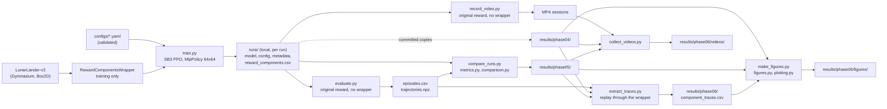

# Architecture

## Data flow



Plain-text version:

```text
config -> [env -> RewardComponentsWrapper] -> PPO training -> runs/<exp>/<run>/ (local)
runs/  -> evaluation (original reward, no wrapper) -> episodes.csv + trajectories.npz
       -> video recording (original reward, no wrapper) -> MP4 sessions
runs/  -> committed copies -> results/phase04/ (config, metadata, episode CSVs, reward_components.csv)
runs/ metadata + evaluation data -> comparison -> results/phase05/
evaluation data + phase04 configs + phase05 run list -> trace replay -> results/phase06/component_traces.csv
MP4 sessions + phase04 video records + phase05 run list -> clip selection -> results/phase06/videos/
committed phase04 + phase05 + component traces -> figures -> results/phase06/figures/
```

The custom reward exists only inside training. Evaluation, video
recording, the comparison and the figures all use the original environment
reward (D-009). Shaped training totals are reported separately and never
mixed with evaluation returns.

## Modules (`lunar_lander_rl/`)

| Module | Responsibility |
|---|---|
| `environment.py` | Build `LunarLander-v3` (render mode, optional time-limit override); observation and action labels |
| `rollout.py` | Bounded random-policy rollouts for exploration and smoke tests |
| `config.py` | Load and strictly validate the YAML experiment, metrics and visualization configs |
| `reward_functions.py` | Pure reward-term calculations: time penalty, upright-and-slow bonus, potential, shaping term |
| `reward_wrapper.py` | Gymnasium wrapper that adds the configured terms and reports them per step and per episode |
| `reward_logging.py` | SB3 callback that writes per-episode reward components to `reward_components.csv` |
| `train.py` | Configuration-driven PPO training with run directory, checkpoints, TensorBoard and metadata |
| `evaluate.py` | Deterministic evaluation on the original reward; per-episode CSV and per-step trajectories |
| `record_video.py` | Record MP4 clips of evaluation episodes on the original reward |
| `metrics.py` | Outcome labels (D-036), hover and contact diagnostics, per-run and across-seed summaries |
| `comparison.py` | Select runs by metadata, validate raw data, write the Phase 05 comparison tables |
| `traces.py` | Replay recorded episodes through the unchanged wrapper to obtain per-step reward terms (D-041) |
| `video_selection.py` | Copy one clip per run and label it from the recorded data (D-042) |
| `figures.py` | Load and cross-check committed results, build every figure, write the manifest (D-043) |
| `ppo_diagnostics.py` | Copy SB3 `train/*` and `rollout/*` scalars of the compared runs from local TensorBoard logs into `results/phase07/ppo_diagnostics.csv` |
| `plotting.py` | Pure figure builders, with no file I/O and no pyplot global state |
| `artifacts.py` | Write-once files, run directories, hashes and provenance (git revision, package versions) |
| `cli.py` | Shared argparse helpers |

Scripts in `scripts/` are thin command-line wrappers. Each parses
arguments and calls one module function.
- `compare_runs.py`, `extract_traces.py`, `collect_videos.py`,
  `make_figures.py` and `extract_ppo_diagnostics.py` print a one-line error and exit with code 2 on a
  configuration or data error. `train.py` does the same for a configuration
  error.
- `evaluate.py` and `record_video.py` let errors propagate, which prints a
  traceback and exits with code 1.
- `check_environment.py` exits with 1 if any check fails.

## Design rules

- Avoid circular imports. Keep pure reward calculations independently testable.
- Do not reach into Box2D internals for reward shaping. The wrapper sees only
  `step()` and `reset()` outputs.
- Keep evaluation code independent of the custom training reward.
- Store a copy of the effective config with each run.
- Every output is write-once: a script refuses a run directory, session or
  output path that already exists.
- Every artifact records its provenance: source commit, dirty flag, diff
  hash, untracked files, package versions and command line.
