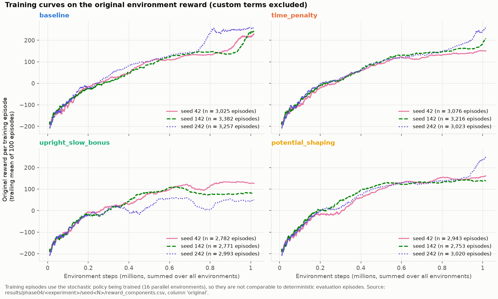
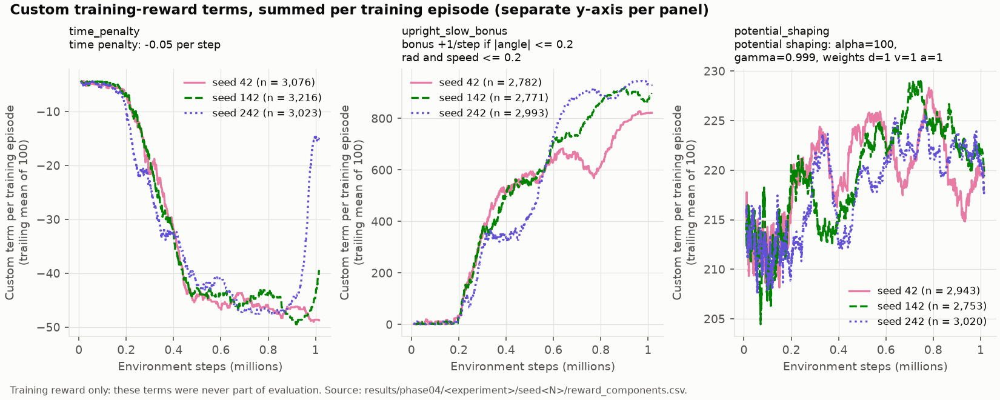
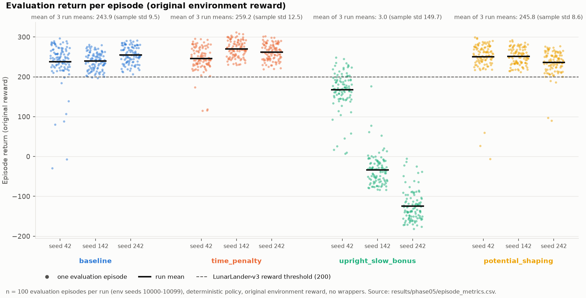
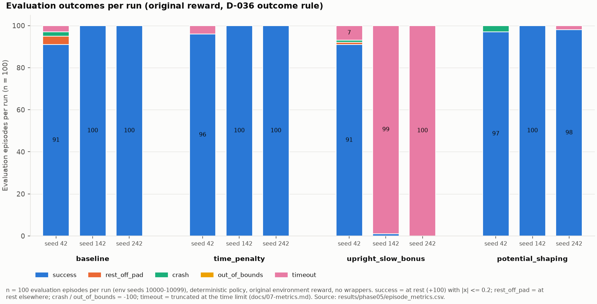
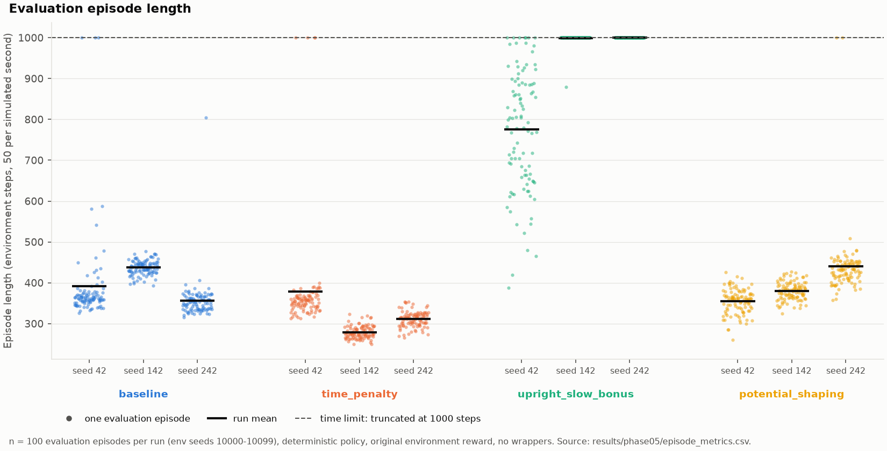
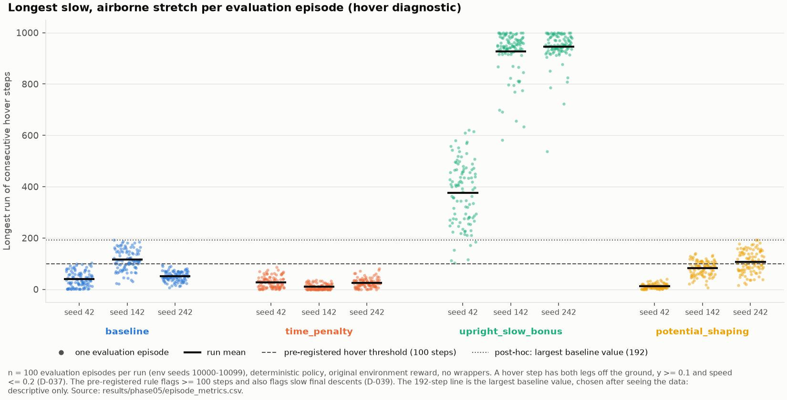
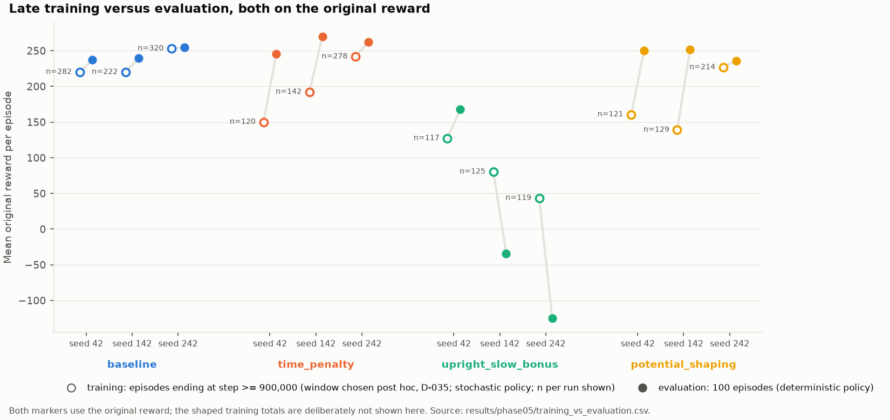
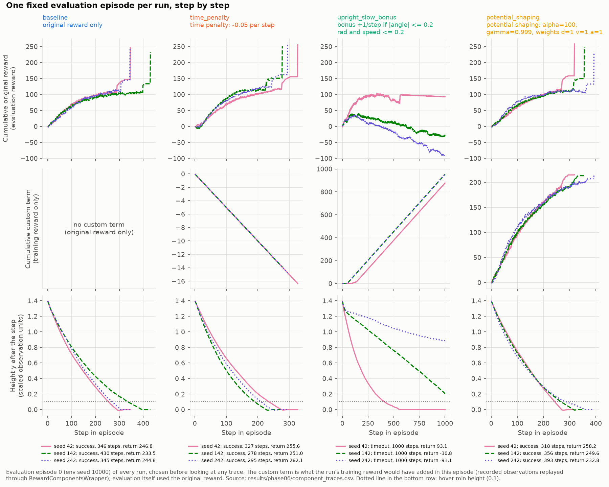

# Experiment Record: Phase 06 — Visual analysis of the four reward configurations

- **Date:** 2026-11-07
- **Question:** what do the training curves, evaluation distributions,
  reward-term traces and clips show about each reward configuration, and
  where does the training reward diverge from the task?
- **Runs:** the 12 Phase 04 runs (4 configurations × training seeds 42, 142,
  242), exactly those listed in `results/phase05/comparison.json`.
- **Code:**
  - Traces and clips: commit `53079be` ("Phase 06 (1/2)").
  - Figures: commit `892252a` ("Phase 06 (2/3)", the review fixes to the
    figure layout; the data handling is unchanged).
  - Every provenance record has an empty `diff_sha256` (no tracked
    changes). `videos.json` and `figures_manifest.json` record
    `dirty: true` only because the outputs of the earlier Phase 06 steps
    were untracked at that point. Those outputs are listed under
    `untracked`, and no code or documentation file is among them.
- **Inputs (all committed):**
  - training: `results/phase04/<experiment>/seed<N>/reward_components.csv`
    (one row per training episode) and `run_config.json`;
  - evaluation: `results/phase05/episode_metrics.csv` (1,200 episodes),
    `config_summary.csv`, `training_vs_evaluation.csv`, `comparison.json`;
  - traces: `results/phase06/component_traces.csv` (6,088 steps from 12
    episodes) and its provenance record `component_traces.json`.
- **Outputs:** `results/phase06/figures/` (8 PNGs and
  `figures_manifest.json` with every input's SHA-256),
  `results/phase06/videos/` (12 clips with `videos.csv`/`videos.json`).
- **Reproducibility:** the figures and the trace CSV were regenerated into a
  separate folder from the same inputs, and all 9 files were byte-identical.
  Commands: `docs/visualization.md`.
- **Statistics:** as in Phase 05 (D-040). The training seed is the unit of
  replication (n = 3 per configuration); no significance tests.

## Reward definitions (from each run's `run_config.json`)

| Configuration | Training reward = original reward + | Evaluation reward |
|---|---|---|
| baseline | nothing | original |
| time_penalty | −0.05 per step | original |
| upright_slow_bonus | +1 per step if \|wrapped angle\| ≤ 0.2 rad and speed ‖(vx, vy)‖ ≤ 0.2 | original |
| potential_shaping | 100·(0.999·Φ(s′) − Φ(s)), Φ(s) = −(‖(x, y)‖ + ‖(vx, vy)‖ + \|wrapped angle\|), Φ(s′) = 0 on termination | original |

Formulas and terminal handling: `docs/reward-wrapper.md`. The evaluation
reward is always the unmodified environment reward (D-009).

## Figures

### 1. Training curves on the original reward

- The curves are trailing means of the original reward over 100 training
  episodes. Training uses the stochastic policy, so they are not comparable
  with deterministic evaluation.
- Baseline, time penalty and potential shaping rise in a similar way over the
  first ~0.6M steps. Late in training the seeds spread. Baseline seed 242
  passes 200 at about 0.78M steps. In the last ~0.1M steps there is a late
  rise in all three non-bonus configurations: baseline seeds 42 and 142
  (trailing mean 160 → 230 and 136 → 243 from 0.9M steps to the end),
  time-penalty seeds 142 and 242, and potential-shaping seed 242.
- upright_slow_bonus tracks the others until about 0.35M steps (seed 242)
  or about 0.65M steps (seeds 42 and 142), then levels off or falls back
  while the other configurations keep rising. Its late-window mean is
  43–127 (`training_vs_evaluation.csv`), below every other configuration.
- **Not observed:** potential shaping did not visibly learn faster than the
  baseline in these three seeds. Potential-based shaping keeps the optimal
  policy unchanged under its assumptions; it does not guarantee faster
  learning.

### 2. Custom training-reward terms

- **Time penalty:** the per-episode total is exactly −0.05 × episode length,
  so this panel is the training episode length rescaled. It falls from about
  −5 (≈ 100-step episodes) to −45 to −50 (≈ 900–1000 steps) between about
  0.2M and 0.5M steps, stays there until about 0.9M, then rises for seeds
  242 (to about −15, ≈ 300 steps) and 142. Long training episodes therefore
  occurred under the time penalty too; the penalty did not prevent them.
- **Upright bonus:** the bonus per training episode rises from about 0 to
  820–950 by the end of training, while the original reward over the same
  episodes levels off (figure 1). In late training the shaped total is
  950–979 per episode against an original reward of 43–127.
  - *Interpretation:* the learner improved the proxy (the bonus) while the
    task reward stopped improving. That is the expected signature of a
    reward that can be collected without completing the task. The evidence
    of what the policy actually does is in figures 4–6 and 8.
- **Potential shaping:** the 100-episode trailing mean of the per-episode
  total stays between 204 and 229 for the whole run (individual episodes
  vary more). Over the same period the training episodes change a lot.
  Early episodes (before 0.1M steps) last about 90 steps on average. Among
  late episodes (ending at step ≥ 900k), 91% (seed 42), 87% (seed 142) and
  20% (seed 242) reach the 1000-step limit (Phase 04 potential-shaping
  record).
  - This follows from the telescoping identity. The episode sum equals
    −α·Φ(s₀), plus α(1 − γ) times the summed |Φ| of the intermediate
    states, plus α·γ·Φ of the last state if the episode was truncated. It
    depends mainly on the start state, not on how the episode went.
  - The three evaluation traces of figure 8 share a start state and give
    215.1–216.3 despite lengths of 318–393 steps. Decomposed from
    `component_traces.csv`, −α·Φ(s₀) is 189.61 in all three, and the
    intermediate-state term is 25.5–26.7.

### 3. Evaluation returns

- 100 episodes per run (env seeds 10000–10099), deterministic policy,
  original reward.
- Mean of the three run means: baseline 243.9 (sample std 9.5), time penalty
  259.2 (12.5), potential shaping 245.8 (8.6), upright_slow_bonus 3.0
  (149.7).
- The three non-bonus configurations overlap at the seed level, and n = 3
  seeds cannot separate them. Time penalty has the highest mean in this
  sample.
- upright_slow_bonus spans 167.7 (seed 42) to −124.7 (seed 242) in run mean.

### 4. Outcomes

- Pooled successes: baseline 291/300, time penalty 296/300, potential
  shaping 295/300, upright_slow_bonus 92/300 (91, 1, 0 by seed). The bonus
  runs have 206 timeouts.
- Non-success outcomes in the other configurations are few: baseline seed 42
  has 4 rest_off_pad, 2 crashes and 3 timeouts; time-penalty seed 42 has 4
  timeouts; potential shaping has 3 crashes (seed 42) and 2 timeouts (seed
  242).

### 5. Episode lengths

- Mean length: time penalty 322.9 steps (seed means 279.0–378.6), baseline
  395.1 (356.3–437.2), potential shaping 391.7 (354.8–440.4),
  upright_slow_bonus 925.0 (776.1–1000). The seed ranges of the three
  non-bonus configurations overlap.
- upright_slow_bonus seeds 142 and 242 reach the 1000-step limit in 99 and
  100 episodes.

### 6. Hover diagnostic

- The longest run of consecutive slow, airborne steps per episode (D-037).
- The pre-registered 100-step threshold also flags ordinary slow final
  descents (D-039): 66 baseline seed-142 episodes (plus 2 in seed 42), and
  29 and 55 in potential-shaping seeds 142 and 242, all but one of them
  successes.
- The dotted 192-step line is the largest baseline value. It was chosen
  after seeing the data and is descriptive only. Potential-shaping seed 242
  also reaches exactly 192, so it has no margin.
- upright_slow_bonus run means are 376.2 (seed 42), 927.4 (142) and 945.1
  (242); every one of its 300 episodes is above 100 (minimum 104, seed 42).

### 7. Late training versus evaluation

- Both markers are on the original reward; shaped training totals are not
  shown (they were never part of evaluation).
- The deterministic evaluation mean is higher than the late-training mean
  of the stochastic training policy in 10 of 12 runs. The largest gaps are
  potential shaping seed 142 (139.0 → 251.6), time penalty seed 42
  (150.1 → 245.6) and potential shaping seed 42 (160.6 → 250.0).
- The exceptions are upright_slow_bonus seeds 142 (80.4 → −34.0) and 242
  (43.4 → −124.7).
- The training window (episodes ending at or after step 900,000) was chosen
  after training (D-035), and training episodes are a different policy
  (stochastic), so this is descriptive.

### 8. One fixed evaluation episode per run

- Evaluation episode 0 (env seed 10000) of every run, fixed in
  `configs/visualization.yaml` before any trace was viewed.
- The custom term is what each run's *training* reward would have added
  over this evaluation episode. It was obtained by replaying the recorded
  observations through the unchanged training wrapper (D-041); evaluation
  itself used the original reward.
- **Baseline, time penalty, potential shaping:** all nine episodes descend
  steadily and land on the pad in 278–430 steps (original return
  232.8–262.1). The cumulative original reward jumps at leg contact and at
  the +100 at-rest termination.
- **upright_slow_bonus**, all three episodes time out at 1000 steps. The
  episode was fixed in advance, but for these runs it is not typical (from
  `episode_metrics.csv`):
  - **Seed 242** never touches down. Height falls from about 1.4 to 0.89 over
    1000 steps, and the bonus is paid on 954 of 1000 steps (original return
    −91.1, training reward 862.9). *Position in its run:* the final height
    is the 13th lowest of 100 (run median 1.345). Most episodes of this seed
    end near spawn height, as in Phase 05 Finding 4; this one sank further
    than usual.
  - **Seed 142** sinks from about 1.4 to 0.21 without touching down. Bonus on
    953 of 1000 steps (original −30.8, training reward 922.2). *Position in
    its run:* the final height is the 19th lowest of 100 (run median 0.404).
  - **Seed 42** touches down on the pad and stays there without ending the
    episode (the unexpected result below). *Position in its run:* this is
    one of only 7 timeouts in 100 episodes (91 succeed), and its return of
    93.1 is the 7th lowest (run median 170.7).

## Unexpected result: upright seed 42 rests on the pad without terminating

This is a one-episode illustration from the 7% tail of seed 42 (see
figure 8). In evaluation episode 0 of upright_slow_bonus seed 42 (from
`component_traces.csv`; velocities in scaled observation units):

- First leg contact is at step 560. Both legs are in contact on 439 of the
  remaining 441 steps, at x ≈ −0.06 (on the pad).
- From step 569 to the end (432 steps), |vx| ≤ 0.0075 and |vy| ≤ 0.0051.
  The bonus is paid on all 441 steps from first contact.
- Of those 441 steps, the policy fires the right orientation engine on 228
  and does nothing on 211; the other 2 are one main-engine and one
  left-engine step. The longest run of consecutive no-ops is 5 steps.
- The episode never receives the +100 at-rest termination. That happens
  only when Box2D puts the lander body to sleep (`docs/environment-notes.md`).
  It is truncated at step 1000 with an original return of 93.1.

**Why it does not come to rest (evidence from the source, not an
intervention test):**
- Gymnasium applies every orientation-engine impulse with `wake=True`
  (`gymnasium/envs/box2d/lunar_lander.py`, `ApplyLinearImpulse(..., True)`).
- Box2D lets a body sleep only after it has been still for
  `b2_timeToSleep` = 0.5 s, which is 25 steps at 50 FPS.
- With at most 5 consecutive no-ops on the ground, the body cannot reach
  that timer, so the episode cannot end at rest; it ends by truncation.

**Interpretation, not tested:** under the training reward, ending the episode
at rest pays +100 once, while staying upright and slow pays +1 per step. The
observation has no time feature, and SB3 bootstraps the value at truncation
(D-027). From the learner's point of view, staying is therefore worth up to
about 1/(1 − γ) = 1000. Even counting only the 440 steps left, it is worth
about 356 discounted. Either way it exceeds the +100.

How often a policy stays on the ground until truncation (post hoc and
descriptive, from the committed `episode_metrics.csv`: outcome `timeout`, a
first contact recorded and final |y| < 0.05; steps after first contact =
1000 − `first_contact_step`):

| Run | Timeouts matching | On the pad (final \|x\| ≤ 0.2) | Steps after first contact |
|---|---|---|---|
| upright_slow_bonus seed 42 | 4 of 7 | 4 | 334–440 |
| upright_slow_bonus seed 142 | 3 of 99 | 3 | 17, 50, 92 |
| upright_slow_bonus seed 242 | 0 of 100 | – | – |
| baseline seed 42 | 3 of 3 | 0 | 645–691 |
| time_penalty seed 42 | 4 of 4 | 1 | 670–748 (748 on the pad) |
| potential_shaping seed 242 | 2 of 2 | 1 (\|x\| = 0.198) | 616–647 (647 on the pad) |

- The three seed-142 cases first touch down at steps 908–983. They are late
  landings cut off by the time limit, not long stays: successful seed-42
  episodes need a median of 37 steps from contact to rest (Phase 05
  Finding 5).
- Long stays on the ground without coming to rest therefore occur in every
  configuration, but rarely: 4 upright seed-42 episodes, and 3, 4 and 2
  episodes in baseline, time penalty and potential shaping, most of them off
  the pad.
- The bonus explains why staying pays during training for upright seed 42.
  It is not the only way such episodes arise.

This refines Phase 05 Finding 5. That finding describes seed 42's
successful episodes (a short time on the ground before coming to rest). In
4 of its 7 timeouts, the extra time is spent on the ground.

## Videos

One clip per run: video episode 0 (env seed 20000; deterministic policy;
original environment). The selection was fixed before any clip was opened.
The clips are in `results/phase06/videos/`, and their labels come from the
committed `video_episodes.csv` and the D-036 outcome rule (`videos.csv`).

| Configuration | Seed 42 | Seed 142 | Seed 242 |
|---|---|---|---|
| baseline | success, 370 steps | success, 443 | success, 356 |
| time_penalty | success, 362 | success, 264 | success, 318 |
| upright_slow_bonus | success, 906 | timeout, 1000 | timeout, 1000 |
| potential_shaping | success, 394 | success, 394 | success, 425 |

- Each clip is copied from the newest video session whose `episodes.csv` is
  byte-identical to the committed copy. Each clip is also byte-identical in
  both recorded sessions.
- **Viewing status:** no clip was watched in this phase. The project owner
  will watch them later. In Phase 04 the owner reviewed the
  upright_slow_bonus clips of all three seeds; the session viewed was not
  recorded, but episode 0's clip is the same file in both sessions. The
  other 9 clips are not reviewed.
- Video episodes use env seeds 20000–20002, not the evaluation seeds. For
  example, upright seed 42 succeeds in video episode 0 but times out in
  evaluation episode 0.

## Summary of behaviours

- **Positive:** baseline, time penalty and potential shaping all solve the
  task on the original reward (97.0–98.7% success on average across seeds).
  Potential shaping showed no difference from the baseline that n = 3
  seeds can detect. Policy invariance concerns the optimal policy; it makes
  no promise about finite PPO runs (`docs/reward-wrapper.md`).
- **Negative:** potential shaping did not improve evaluation return or
  visible learning speed over the baseline in this sample. The time penalty
  did not prevent long episodes during training.
- **Reward hacking (upright_slow_bonus):** the bonus rises to 820–950 per
  training episode while the original reward levels off. In evaluation, two
  seeds stay airborne for almost every episode. Seed 242 stays near spawn
  height (median final y 1.345) and seed 142 sinks very slowly (median final
  y 0.404) (`final_y` in `episode_metrics.csv`). The third seed mostly lands,
  but 4 of its 7 timeouts end on the pad after touchdown without coming to
  rest. Bonus collection on the ground was traced in one of them
  (evaluation episode 0) only.
- **Training reward is not task performance:** the highest late-training
  shaped totals (upright, 950–979) go with the lowest evaluation returns.

## Limitations

- Three training seeds per configuration, and the seed is the unit of
  replication. The upright configuration's seeds differ sharply, so its
  mean describes these three seeds only.
- Each reward magnitude was tested at one value (D-032).
- Figure 8 shows one episode per run. It illustrates behaviour; it is not a
  distribution. For the upright runs, episode 0 lies in the tail of each
  run (see figure 8). The population statements come from
  `episode_metrics.csv`.
- The grounded-timeout filter above, and the 192-step line, were defined
  after seeing the data and are descriptive.
- Building `component_traces.csv` needs the local, git-ignored
  `trajectories.npz`. Once built, the figures regenerate from Git alone.
- Training curves come from the stochastic training policy across 16
  parallel environments, smoothed over 100 episodes.
- The clips have not been watched in this phase; their labels come from
  data only.
- One machine and one software stack (versions in each provenance record).
